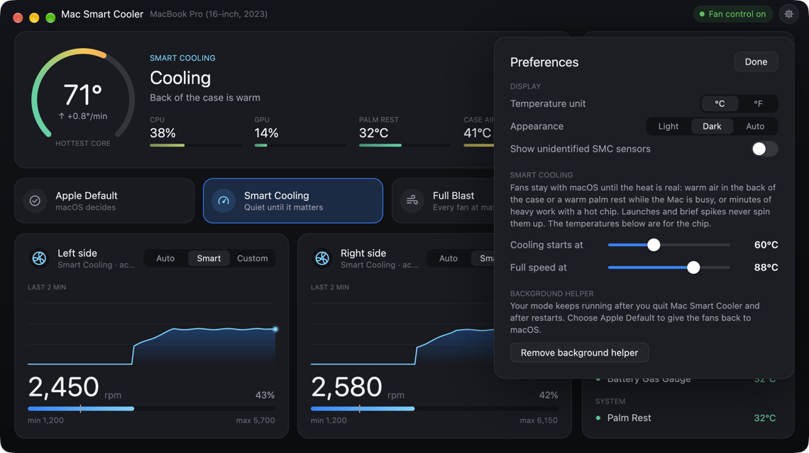

# Mac Smart Cooler

A fan control and temperature monitor for Macs (Apple Silicon and Intel), written in Rust.
It reads the temperature sensors and drives the fans directly through the Mac's System
Management Controller (SMC), and adds **Smart Cooling**: the fans stay quiet during everyday
work and only step in when heat is real and sustained.


| Light mode | A fan following a sensor | Preferences |
|---|---|---|
|  |  |  |

The screenshots use made-up readings (`scripts/screenshots.sh docs`).

## Install

Needs macOS 11 or later. Release downloads are for Apple silicon (M1 or later).

**The quick way.** Open **Terminal** (press ⌘Space, type `Terminal`, press Return), paste this
and press Return:

```sh
/bin/sh -c 'set -e; cd "$(mktemp -d)"; R=https://github.com/anilcharles/mac-smart-cooler/releases
TAG=$(curl -fsSLo /dev/null -w "%{url_effective}" "$R/latest"); TAG=${TAG##*/}
DMG=Mac-Smart-Cooler-${TAG#v}-arm64.dmg
curl -fL --progress-bar -O "$R/download/$TAG/$DMG" -O "$R/download/$TAG/$DMG.sha256"
shasum -a 256 -c "$DMG.sha256"
hdiutil attach -nobrowse -quiet -mountpoint mnt "$DMG"
osascript -e "quit app \"Mac Smart Cooler\"" 2>/dev/null || true
rm -rf "/Applications/Mac Smart Cooler.app"; ditto "mnt/Mac Smart Cooler.app" "/Applications/Mac Smart Cooler.app"
hdiutil detach -quiet mnt; open "/Applications/Mac Smart Cooler.app"; echo "Installed $DMG"'
```

It downloads the latest release, checks it against its `.sha256`, copies the app into
Applications (replacing an older copy) and opens it. Your mode and the background helper are
not touched: the helper keeps running and the new app picks it up.

The `.sha256` catches a broken download but comes from the same release, so it can't show who
published it. `codesign -dv "/Applications/Mac Smart Cooler.app" 2>&1 | grep TeamIdentifier`
shows who signed the app.

**Or ask an AI assistant.** Paste this into Claude, ChatGPT or another assistant. One that can
run commands on your Mac (such as Claude Code) can do the install for you. A chat-only one
walks you through it step by step.

```text
Help me install the Mac app "Mac Smart Cooler" from its GitHub releases:
https://github.com/anilcharles/mac-smart-cooler/releases/latest

1. Download only from that repository's latest release: Mac-Smart-Cooler-<version>-arm64.dmg
   and Mac-Smart-Cooler-<version>-arm64.dmg.sha256 (curl works; no GitHub account needed).
2. Check the download with: shasum -a 256 -c Mac-Smart-Cooler-<version>-arm64.dmg.sha256
   Stop and tell me if the check fails.
3. Quit Mac Smart Cooler if it is running, then copy "Mac Smart Cooler.app" from the DMG into
   /Applications, replacing any older copy.
4. Open the app. If macOS says "Apple could not verify Mac Smart Cooler is free of malware",
   don't move it to the Bin. Clear the quarantine flag on this one app only:
   xattr -dr com.apple.quarantine "/Applications/Mac Smart Cooler.app"
   Never turn off Gatekeeper or System Integrity Protection.
5. Fan control needs a small background helper. I will click "Enable fan control" in the app
   and type my password into the macOS prompt myself. Never ask me for my password and never
   run the install with sudo for me.

The app needs a Mac with Apple silicon (M1 or later). If you can run commands on my Mac, do
these steps yourself and tell me what you did. If you can't, walk me through them one at a
time in Terminal.
```

**Or by hand:**

1. Download `Mac-Smart-Cooler-<version>-arm64.dmg` from
   [Releases](https://github.com/anilcharles/mac-smart-cooler/releases). The release notes there
   list what changed.
2. Open the DMG and drag **Mac Smart Cooler** onto **Applications**.
3. Open Mac Smart Cooler from Applications.

**"Apple could not verify Mac Smart Cooler is free of malware".** macOS can show this the first
time you open a copy downloaded in a browser, because the app is not notarized by Apple. Don't
click **Move to Bin**. Click **Done**, then either open **System Settings → Privacy & Security**
and click **Open Anyway**, or run
`xattr -dr com.apple.quarantine "/Applications/Mac Smart Cooler.app"` and open the app again.

**Then turn on fan control.** Click **Enable fan control** (top right). macOS asks for your
password once to install a small background helper. Pick a mode. That's it: the mode keeps
running after you close the app and after restarts. Without the helper the app still works as a
read-only temperature and fan monitor.

## Modes

| Mode | What the fans do |
|---|---|
| **Apple Default** | macOS controls the fans, exactly as if the app weren't installed. |
| **Smart Cooling** | macOS keeps the fans until heat builds up and lasts, then Mac Smart Cooler cools until it's gone. |
| **Full Blast** | Every fan at its maximum speed. |

Each fan can also run its own mode, including a fixed speed or a ramp that follows any sensor.
How Smart Cooling decides, and which Macs are supported (Apple silicon M1 to M6 and Intel;
tested so far on a 16-inch M1 Max), is in **[Modes and Smart Cooling](docs/smart-cooling.md)**.

## Security

Reading sensors needs no privileges. Writing fan speeds needs root, so **Enable fan control**
installs a small launchd helper that runs as root; the app talks to it over a Unix socket.

- Only root or the person at the screen can change fans or settings; other accounts can only
  read the status. Every value is checked before it reaches the fan controller.
- The install prompt runs a root-only copy of the app, checked against the team ID built into
  the release.
- If the helper crashes, fans go back to macOS before it restores your mode.
- A source-only audit (November 2026) found no confirmed vulnerabilities and left a few open
  leads, mostly in the helper install step. Use the helper rather than running the window
  with `sudo`.

Details and the open leads are in **[How it works](docs/how-it-works.md)**.

## Build

```sh
cargo test --release      # logic tests, incl. fan takeover on simulated Macs
./scripts/make-dmg.sh     # builds dist/Mac Smart Cooler.app and dist/MacSmartCooler.dmg
```

The command line, the release runner setup and the source layout are in
**[Development](docs/development.md)**.

## Credits

Created with [Claude](https://claude.com/claude-code).
