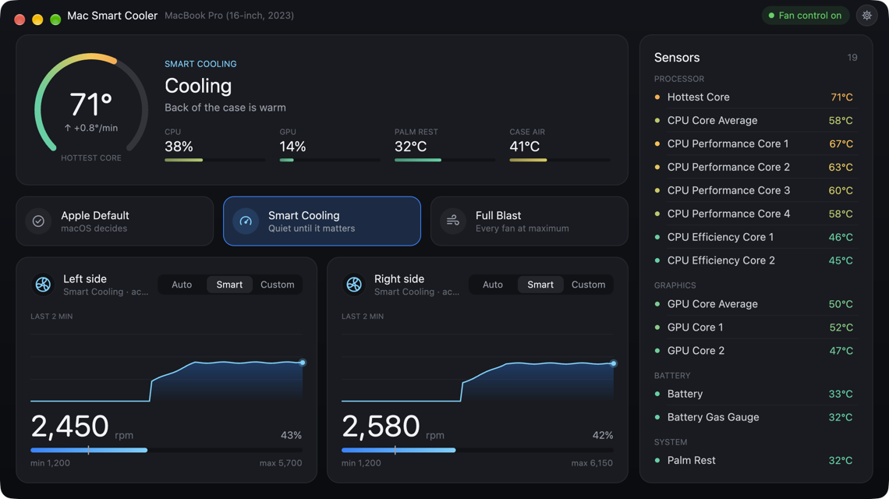
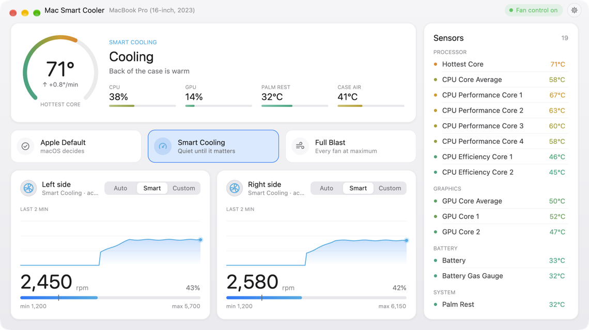
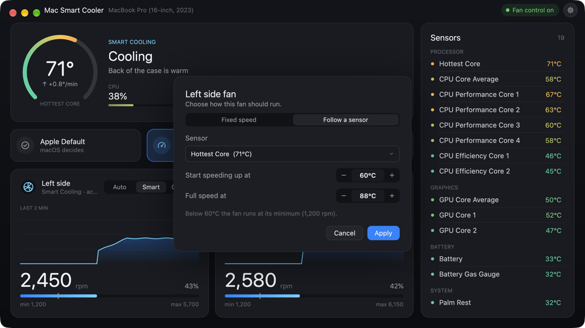

# Mac Smart Cooler

A fan control and temperature monitor for Macs (Apple Silicon and Intel), written in Rust.
It reads the temperature sensors and drives the fans directly through the Mac's System
Management Controller (SMC), and adds **Smart Cooling**: the fans stay quiet during everyday
work and only step in when heat is real and sustained.





| A fan following a sensor | Preferences |
|---|---|
|  |  |

The screenshots use made-up readings (`scripts/screenshots.sh docs`).

## Install

Needs macOS 11 or later. Release downloads are for Apple silicon (M1 or later).

**The quick way.** The repository is private, so downloads go through the GitHub command-line tool
`gh`, signed in to an account that can see it (`brew install gh`, then `gh auth login`). Open
**Terminal** (press ⌘Space, type `Terminal`, press Return), paste this and press Return:

```sh
/bin/sh -c 'set -e; cd "$(mktemp -d)"; R=anilcharles/mac-smart-cooler
gh release download --repo "$R" --pattern "Mac-Smart-Cooler-*-arm64.dmg*"
DMG=$(ls Mac-Smart-Cooler-*-arm64.dmg); shasum -a 256 -c "$DMG.sha256"
hdiutil attach -nobrowse -quiet -mountpoint mnt "$DMG"
osascript -e "quit app \"Mac Smart Cooler\"" 2>/dev/null || true
rm -rf "/Applications/Mac Smart Cooler.app"; ditto "mnt/Mac Smart Cooler.app" "/Applications/Mac Smart Cooler.app"
hdiutil detach -quiet mnt; open "/Applications/Mac Smart Cooler.app"; echo "Installed $DMG"'
```

It downloads the latest release, checks it against its `.sha256`, copies the app into
Applications (replacing an older copy) and opens it. Your mode and the background helper are
not touched: the helper keeps running and the new app picks it up.

**Or ask an AI assistant.** Paste this into Claude, ChatGPT or another assistant. One that can
run commands on your Mac (such as Claude Code) can do the install for you. A chat-only one
walks you through it step by step.

```text
Help me install the Mac app "Mac Smart Cooler" from its GitHub releases:
https://github.com/anilcharles/mac-smart-cooler/releases/latest
The repository is private, so use the GitHub CLI (gh), signed in to my account.

1. Download only from that repository:
   gh release download --repo anilcharles/mac-smart-cooler --pattern "Mac-Smart-Cooler-*-arm64.dmg*"
2. Check the download with: shasum -a 256 -c Mac-Smart-Cooler-<version>-arm64.dmg.sha256
   Stop and tell me if the check fails.
3. Quit Mac Smart Cooler if it is running, then copy "Mac Smart Cooler.app" from the DMG into
   /Applications, replacing any older copy.
4. Open the app. If macOS says "Apple could not verify Mac Smart Cooler is free of malware",
   don't move it to the Bin. Clear the quarantine flag on this one app only:
   xattr -dr com.apple.quarantine "/Applications/Mac Smart Cooler.app"
   Never turn off Gatekeeper or System Integrity Protection.
5. Fan control needs a small background helper. I will click "Enable fan control" in the app
   and type my password into the macOS prompt myself. Never ask me for my password and never
   run the install with sudo for me.

The app needs a Mac with Apple silicon (M1 or later). If you can run commands on my Mac, do
these steps yourself and tell me what you did. If you can't, walk me through them one at a
time in Terminal.
```

**Or by hand:**

1. Download `Mac-Smart-Cooler-<version>-arm64.dmg` from
   [Releases](https://github.com/anilcharles/mac-smart-cooler/releases). The release notes there
   list what changed.
2. Open the DMG and drag **Mac Smart Cooler** onto **Applications**.
3. Open Mac Smart Cooler from Applications.

**"Apple could not verify Mac Smart Cooler is free of malware".** macOS can show this the first
time you open a copy downloaded in a browser, because the app is not notarized by Apple. Don't
click **Move to Bin**. Click **Done**, then either open **System Settings → Privacy & Security**
and click **Open Anyway**, or run
`xattr -dr com.apple.quarantine "/Applications/Mac Smart Cooler.app"` and open the app again.

**Then turn on fan control.** Click **Enable fan control** (top right). macOS asks for your
password once to install a small background helper. Pick a mode. That's it: the mode keeps
running after you close the app and after restarts. Without the helper the app still works as a
read-only temperature and fan monitor.

## Supported Macs

- **Apple silicon M1 to M6** (base, Pro, Max, Ultra) and **Intel** Macs with fans. Fanless
  Macs (MacBook Air) can monitor temperatures only.
- Apple reuses sensor keys with different meanings on each chip generation, so core sensors
  are named from a per-generation table, based on the one maintained by the open-source
  [Stats](https://github.com/exelban/stats) app. On a chip newer than the table, its CPU/GPU
  sensors are still found by key family and shown as "Chip Sensor …", so Smart Cooling
  always has a chip temperature.
- "Hottest CPU/GPU" uses every CPU/GPU-family sensor (`Tp`/`Te`/`Tf`/`Tg`), not only the
  labelled cores. The labels differ between sources (Stats and
  [iSMC](https://github.com/dkorunic/iSMC) disagree on M3), and on an M1 Max the labelled
  cores read about 10 °C below the SMC's own "CPU die max" (`TCMz`), which this matches.
- `Ts0P`/`Ts1P` are used as palm-rest temperature, following the
  [Asahi Linux SMC notes](https://asahilinux.org/docs/hw/soc/smc/); iSMC labels them SSD
  controller sensors instead, so treat that reading with some caution.
- Manual fan control follows each generation's method: M5 and later switch fans directly;
  M1-M4 first unlock fan control from macOS (`Ftst`), which can take a few seconds. Some
  Macs use a lowercase fan-mode key (`F0md`); both are handled.
- Smart Cooling's case-air and palm-rest thresholds were tuned on a 16-inch M1 Max. Other
  models may run warmer or cooler; `macsmartcooler watch` shows what it decides and why.
- Only the 16-inch M1 Max has been tested on real hardware so far.

## Modes

The top of the window (and the menu bar icon) offers three presets:

| Mode | What the fans do |
|---|---|
| **Apple Default** | macOS controls the fans, exactly as if the app weren't installed. |
| **Smart Cooling** | macOS keeps the fans until heat builds up, then Mac Smart Cooler takes over and cools until the heat is gone (see below). |
| **Full Blast** | Every fan at its maximum speed. |

Each fan card also has its own **Auto | Smart | Custom** switch, so fans can run different
modes. **Custom** offers:

- **Fixed speed:** a constant rpm between the fan's minimum and maximum.
- **Follow a sensor:** a straight-line ramp from minimum speed at a start temperature to full
  speed at a top temperature, following any sensor you pick.

When fans run different modes, the top of the window shows **Custom**.

## How Smart Cooling works

Apple Silicon is designed to run hot. A chip at 80 °C is normal, so chip temperature alone
is a poor reason to spin the fans. Smart Cooling instead watches what you actually feel and
what builds up over time. Once a second it reads:

- **Chip:** the hottest CPU/GPU core.
- **Case air:** the airflow sensors in the back of the case, by the vents.
- **Palm rest:** the surface temperature under your wrists.
- **Battery:** its temperature, and whether it's charging. Charging heats the battery even
  when the Mac is idle, and sustained heat above ~40 °C wears lithium cells faster.
- **Load:** CPU and GPU utilisation.

### Filtering out noise

Core temperatures jump by several degrees from one second to the next, and launching an app
spikes them for a moment. Before any decision is made:

- the chip reading goes through a 9-second median filter (spikes shorter than ~4 s vanish),
  then a ~30-second average;
- load is averaged over ~30 seconds, so a burst of work doesn't count as "busy" (busy means
  over 50% sustained);
- case air is averaged over ~15 seconds.

### When the fans take over

macOS keeps the fans until one of these holds:

| Condition | Must last |
|---|---|
| Busy **and** case air ≥ 45 °C, or busy **and** palm rest ≥ 35 °C | 20 s |
| Case air ≥ 52 °C or palm rest ≥ 38 °C, busy or not | 20 s |
| Charging **and** battery ≥ 38 °C, or battery ≥ 41 °C at any time | 20 s |
| Busy **and** chip past halfway between "cooling starts" and "full speed" (74 °C by default) | 2½ min |
| Chip at the "full speed" temperature (88 °C by default), busy or not | 45 s |

So opening apps, compiling for a minute or a game launcher updating won't spin the fans up,
but a long render will.

### How fast the fans spin

While cooling, the speed is the highest of three demands:

- **Case air:** minimum speed at 42 °C, full speed at 64 °C. This counts the most.
- **Palm rest:** minimum speed at 35 °C, full speed at 42 °C.
- **Battery:** minimum speed at 37 °C, full speed at 47 °C.
- **Chip:** counts at half weight up to the "full speed" temperature (the trend over the last
  minute is added, so a chip that's climbing gets a head start). Above it the chip alone
  ramps the fans to full speed over the next 6 °C.

**Heat soak.** That curve alone settles wherever heat in equals heat out. During a long
Blender render that left the case air stuck around 51 °C at about 3,000 rpm while the
bottom of the case kept getting hotter. So on top of the curve, Smart Cooling keeps adding
speed for as long as the case air stays above **45 °C** (or the palm rest above 36 °C, or the
battery above 39 °C). The
further over, the faster it climbs: 5 °C over adds a step about every 50 seconds. If the heat
never drops, the fans reach full speed. Once the case is more than 1 °C under target, the
extra speed fades slowly (about a step every 2 minutes).

**Steady, not hunting.** The speed moves in 8 fixed steps between the fan's minimum and
maximum. It steps up as soon as more cooling is needed, but only steps down after 30 seconds
of headroom. The actual rpm then ramps toward the step: up to 300 rpm/s when speeding up,
80 rpm/s when slowing down, so changes are quick when it matters and quiet otherwise.

### Handing back to macOS

The fans go back to macOS after **45 seconds of calm**: palm rest under 34 °C, case air under
42 °C, battery under 37 °C, chip under 85 °C, and either the chip below 60 °C or the work has stopped and the
chip is no longer warming.

The status card shows what Smart Cooling is doing and why, for example
*"Quiet: no sustained heat, fans left to macOS"* or
*"Cooling: heat is building up, pushing harder"*.

**Preferences** let you move the two chip temperatures ("Cooling starts at", default 60 °C,
and "Full speed at", default 88 °C). Case air and palm rest thresholds are fixed.

## How the app is put together

```
 Mac Smart Cooler.app (runs as you)          background helper (runs as root)
 ┌──────────────────────────────┐            ┌──────────────────────────────┐
 │ window + menu bar icon       │  "get" /   │ worker loop, once a second:  │
 │ shows sensors, fans, status  │  "set …"   │  read sensors, fans, load    │
 │ sends mode changes ──────────┼──────────► │  run Smart Cooling           │
 │                              │ Unix socket│  write fan speeds to the SMC │
 └──────────────────────────────┘            └──────────────────────────────┘
```

- **Reading needs no privileges**, so the app reads sensors and fans itself.
- **Writing fan speeds needs root.** "Enable fan control" installs a launchd daemon
  (`local.macsmartcooler.helper`) that runs the same binary as root. The app sends it commands
  over `/var/run/macsmartcooler.sock`, so you only enter a password once.
- The helper saves the chosen preset in `/Library/Application Support/MacSmartCooler/settings.txt`
  (root-owned; only root writes it) and re-applies it at boot, so cooling continues after a
  restart even before you open the app. Without the helper, the app keeps its settings in
  your own `~/Library/Application Support/MacSmartCooler`.
- **Security:**
  - Any account can read the helper's status, but only root or the person logged in at
    the screen can change fans or settings. Callers are identified before they take a
    connection slot, and trusted callers have their own pool, so other accounts can't
    crowd them out. Every value is validated before it reaches the fan controller, and
    each request is limited in size and time.
  - Root reads settings only from its own root-owned file. Every settings read refuses
    symlinks, special files and files others can write, and stops at 4 KiB.
  - Approving the install prompt doesn't run the app from where it sits: root first copies
    the app into a fresh root-only folder, checks that the copy is signed by the team ID
    built into the release (`make-dmg.sh` sets it from your signing certificate), and only
    then runs that copy. Builds without a signing team skip the signature check.
  - The app asks for your password on its own only when the helper answers with a different
    version. A helper that isn't answering shows a **Repair helper** button instead.
- The helper's version is a hash of the fan-logic source files. When an app update changes
  that logic, the app notices the installed helper is outdated and asks to replace it.
- **If the helper crashes or is killed:** when launchd restarts it, it first hands any fan
  still held by the previous run back to macOS (and clears the `Ftst` unlock), then restores
  each fan's exact mode, Custom included. If its fan-control thread fails, it hands the fans
  back and exits so launchd starts a fresh one, rather than leaving fans at a fixed speed.
- **Apple Default** hands every fan back to macOS's own control. To remove the helper
  entirely, use **Preferences → Remove background helper**.

### Talking to the SMC

The SMC is reached through IOKit's `AppleSMC` service using four-character keys:

- `FNum` (number of fans), `F<n>Ac` (actual rpm), `F<n>Mn` / `F<n>Mx` (min/max rpm),
  `F<n>Tg` (target rpm);
- manual control via `F<n>Md` (plus `Ftst` on Apple Silicon) or `FS! ` on Intel;
- temperatures from keys such as `Tp0*` (CPU cores), `Tg0*` (GPU cores), `TaLP`/`TaRF`
  (case airflow) and `Ts0P`/`Ts1P` (palm rest).

## Command line

The app's binary also works from the terminal (`/Applications/Mac Smart Cooler.app/Contents/MacOS/macsmartcooler`):

    macsmartcooler                   open the window
    macsmartcooler list              print fans and every temperature sensor
    macsmartcooler watch             print Smart Cooling's decision every second (changes nothing)
    sudo macsmartcooler set 0 3000   fan 0 to a fixed 3000 rpm
    sudo macsmartcooler auto [fan]   give one fan (or all) back to macOS
    sudo macsmartcooler smart        run Smart Cooling in the terminal until Ctrl-C
    macsmartcooler install-helper    install the background helper
    macsmartcooler uninstall-helper  remove it

`watch` is the easiest way to see why the fans are (or aren't) running.

## Build

    cargo test --release         # logic tests, incl. fan takeover on simulated Macs
    macsmartcooler selftest      # real hardware: the installed helper must take and hold the fans
    ./scripts/make-dmg.sh        # builds dist/Mac Smart Cooler.app and dist/MacSmartCooler.dmg

The tests replay situations measured on a real M1 Pro (app launches, noisy sensors, a game
launcher, hours of Blender) and check that Smart Cooling stays quiet or cools as expected.

## Source layout

| File | Role |
|---|---|
| `src/smc.rs` | Raw AppleSMC client: read, write and list keys, decode value types |
| `src/fans.rs` | Fan info and switching fans between manual and automatic |
| `src/sensors.rs` | Finds temperature keys and gives them readable names |
| `src/load.rs` | CPU and GPU utilisation |
| `src/worker.rs` | The once-a-second control loop and Smart Cooling (`SmartCtl`) |
| `src/helper.rs` | Background helper: install/remove, socket server, restore preset at boot |
| `src/auth.rs` | macOS admin password prompt |
| `src/settings.rs` | Saved preset and preferences |
| `src/state.rs` | App-wide state: the worker, the menu bar item, settings, fan history |
| `src/ui.rs` | The window (GPUI): status card, modes, fans, sensors, dialogs |
| `src/widgets.rs`, `src/theme.rs` | Building blocks and colours (light/dark, zoom) |
| `src/charts.rs`, `src/elided.rs` | Ring gauge, rpm history, one-line text with "…" |
| `src/ui_prefs.rs` | Appearance and zoom (window only, not shared with the helper) |
| `src/tray.rs` | Menu bar icon and menu |
| `src/main.rs` | Command-line entry points, app menus and shortcuts |

Debug builds can capture every screen as PNGs from made-up data:
`scripts/screenshots.sh [dir]` (light and dark, 85%, 100% and 150% zoom).
